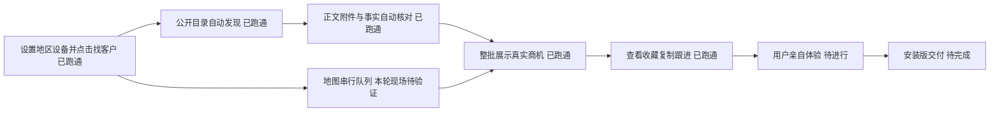

# 杭州单城自动闭环 v0.4 实施记录

本轮实现和真实验收已证明：从界面设置杭州与设备、点击找客户，到公开目录发现、正文与附件核对、采购商机统一展示，可以自动完成一个真实案例。不是安装版或全国供给验收。

## 真实案例

- 来源： https://ljhjny.com/notice/show/id/6005.html ，程序从公开目录发现，没有手工预填 URL 或事实。
- 项目：2026年—2027年驾驶式洗地车采购，采购方杭州临江环境能源有限公司。
- 原公告 2026-10-15 发布；报价及文件获取参与截止 2026-10-23 10:30（北京时间）。核验时间为 2026-10-16 01:15 UTC 附近。
- 附件提供杭州市钱塘区临江街道红十五路10388-123号厂区交付地址；公告业务联系方式与采购方关联，监督电话未作为采购电话使用。未核验接通或真实购买意向。
- 一张税务查询示例图由本机 Windows OCR 自动识别，结合紧邻的查询示例段落判断为非采购关键图片。其余未知图片仍进入待核实；不按项目名或文件哈希放行。
- 资格状态表示公告基础资格要求已提取，不代表任何渠道商已经通过资格审查。

## 本轮能力

- 8 类商用清洁设备统一目录与别名，界面、来源搜索、事实提取和地图关键词共用配置。
- 自动核对增加参与窗口、资格原文、实际地点和采购主体要求；缺失项不进入推荐。
- 本批处理期间保留历史名单，完成后统一发布新结果和数量；失败、暂停及覆盖限制独立展示。
- 公告续批排除已处理 URL；地图续批保留原查询范围及检查点，重置本批数量。
- 公告已有可靠商务电话时不再发起企业地图搜索。自动地图关联需全称、城市、区县和街道门牌依据一致；歧义保留，不覆盖项目地址。
- 保存附件解析与图片判断依据、各字段原文出处。复制和跟进不触发外部检索。

## 验证记录

- 真实控制器任务：`desktop/.build/hangzhou-auto/2026-10-16T01-13-32-712Z/acceptance.json`。1 候选，1 推荐，无提前曝光，无模型请求。
- 真实 React / preload / IPC / 主进程任务：`desktop/.build/precise-preview/runs/2026-10-16T01-15-24-102Z/acceptance.json`。目录发现到客户卡、收藏、隔离复制回执、本地跟进均通过；1320 / 1024 截图保存在同目录。无模拟采购事实。部分其他来源失败会明确显示，不影响已核实结果。
- 界面构建通过；附件、图片判断、公开来源、精准控制器及地图续批相关定向检查通过。最终提示文案修改另做 TSX 语法检查通过。
- 高德原进程及调试端口本轮已不存在，没有重启窗口或访问、清理账号。地图真实联跑未重新验证；代码回归不能替代该项。
- 免费公开读取及本机 OCR，无收费 AI/OCR、客户联系、真实发布、账号同步或安装覆盖。

## 用户体验入口与剩余工作

在本工作区双击 `desktop/scripts/open-precise-public-preview.cmd`，打开隔离单机预览。使用真实公开来源，需有本地 Node 与项目依赖。首次保存杭州及设备后点击找客户，可查看依据、收藏和记录。该预览地图入口不会访问原高德账号；剪贴板为隔离验收实现，不会改变系统剪贴板。

下一步先让用户实际走完这条流程，再在已登录高德运行环境验收地图联跑。安装版尚未更新；当前工作区包含此前未提交改动，本轮未提交、推送或发布。单城、单日期、单类设备正例不能代表全部设备、四类业务或持续商机供给都已验证。
